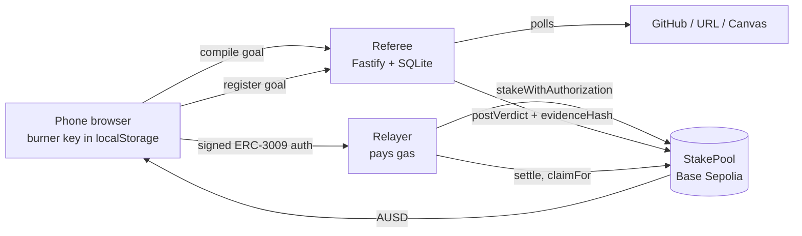

# AI Referee

> **Testnet only.** Everything runs on Base Sepolia with free test AUSD. Nothing here has real value.

Put testnet AUSD behind any task with a deadline. An AI referee gathers the evidence itself, rules pass or fail with reasons, and posts the verdict on-chain where anyone can check it. Stakes from missed tasks go to the people who finished. The operator has no way to withdraw.

Today the referee checks two kinds of evidence: commits pushed to a public GitHub repo, and a public page going live with the promised content. (A Canvas check exists for the team's own account only.)

Live app: [AI Referee](https://considering-particles-fraction-bool.trycloudflare.com). This laptop tunnel must stay running during the demo.

Built at B@BHacks 2.0. Tracks: AUSD, YZi Labs, General (Most Creative).

## What makes it different

1. **The referee observes evidence itself.** It never trusts uploads or claimed timestamps. It records when it first saw each commit, so a commit backdated with `git commit --date` does not count.
2. **It is built to be hard to cheat.** Control proofs, first-seen timing, a two-model substance check, and prompt-injection hardening run on every task. We attack it ourselves with scripted cheats (`redteam/`) and publish the results on the Integrity page, including anything it missed. Cheating is something the system prevents, not a feature.
3. **Every ruling is checkable, and the referee cannot profit.** Verdicts are hashed and posted on-chain, and the browser re-verifies them. The contract has no owner withdrawal; if no verdict is posted, the staker gets a full refund.
4. **Agents pay the referee per ruling in AUSD over x402; groups never pay.** Other apps and AI agents can buy a one-off ruling for 0.10 AUSD with HTTP `402 Payment Required` and a gasless ERC-3009 signature, and get back a ruling signed by the referee key. Payment settles only after the ruling is delivered. Details: [`referee/README.md`](referee/README.md#x402-the-referee-as-a-paid-api).

## Groups: do it with friends

A feature on top of the core product, for school work (full proposal: [`docs/PIVOT.md`](docs/PIVOT.md)).

- **Live now: the commitment stake.** Friends join the same market and each stakes on their own task. Start a group with its own stake and deadlines, then split a group project three ways at `/split`: each friend gets an invite link with their task filled in. Whoever delivers gets their stake back plus an equal share of the stakes of whoever did not. No house, no fee.
- **Implemented, awaiting testnet activation: public YES/NO betting on each task.** A separate `MarketPool` takes signed AUSD bets and resolves from the final verdict on `StakePool`. The owner’s wallet cannot bet NO. Winners share the betting pot; missing verdicts or an empty winning side mean refunds. Contract tests, relayer routes, and goal-page betting/claim controls are included. See [deployment and rules](docs/market-pool.md).

## Sponsor tracks

| Track | What we built for it |
| ----- | -------------------- |
| **Best Use of AUSD** | Every stake and payout is AUSD on Base Sepolia, moved with ERC-3009 `ReceiveWithAuthorization` so users never hold gas. The referee is also a paid API: agents buy rulings over **x402** with ERC-3009 `TransferWithAuthorization` (live, tested on-chain). |
| **YZi Labs** | A trusted AI agent that moves money: every decision is hashed and posted on-chain, re-verified in the browser, and red-teamed in public (13 attacks, 0 missed). The contract gives the operator no way to take funds. |
| **General (Most Creative)** | An AI referee that gathers its own evidence instead of trusting uploads, plus Groups for school work. |

## How it works



1. **Join.** Open the site. The web app creates a key in your browser and the relayer sends you 100 test AUSD. You don't need to install anything or save a seed phrase.
2. **Stake.** Type a goal in plain words. The referee compiles it into frozen criteria JSON and shows a one-sentence summary plus a control proof: a nonce file to add to your repo, or a nonce to put on your page. You sign an ERC-3009 `ReceiveWithAuthorization` and the relayer submits it, so you never need ETH.
3. **Watch.** The referee polls your repo or URL and records when it first saw each piece of evidence.
4. **Verdict.** Deterministic checks run first. A `substance` check asks two independent model calls whether the work actually delivers the goal; if they disagree, the goal goes to a human and the override is counted publicly. The verdict JSON is hashed (`keccak256(canonical(verdict))`) and posted on-chain.
5. **Settle.** Ten minutes after the deadline anyone can call `settle`. Passers get their stake back plus an equal share of the forfeits. If nobody passed, or no verdict was posted, everyone is refunded.

## Repo layout

| Path         | What                                                         |
| ------------ | ------------------------------------------------------------ |
| `contracts/` | `StakePool.sol`, Foundry tests, deploy script                |
| `relayer/`   | Gas relayer, AUSD drip, claim trigger                        |
| `referee/`   | Referee API, evidence collectors, verdict engine             |
| `web/`       | Next.js app (join, stake, verdict, market, groups, integrity)  |
| `redteam/`   | Scripted cheats and results table                            |
| `shared/`    | Schemas, ABI, deployments, fixtures, canonical JSON helper   |
| `docs/`      | Demo script and screenshots                                  |

## Running the web app

```bash
cd web
pnpm install
cp .env.example .env.local   # optional: override URLs or set NEXT_PUBLIC_MOCK=1
pnpm dev
```

Service URLs come from `shared/deployments.json` (`relayer_url`, `referee_url`); `NEXT_PUBLIC_RELAYER_URL` / `NEXT_PUBLIC_REFEREE_URL` override them. A service with no URL is served from fixtures (**mock mode**), each one independently; `NEXT_PUBLIC_MOCK=1` forces fixtures for both, for rehearsals and screenshots. Staking stays disabled until the pool is deployed and both services are live.

| Screen        | Route            |
| ------------- | ---------------- |
| Join          | `/`              |
| Stake         | `/stake?cohort=1`|
| Goal/verdict  | `/goals/:id`     |
| Market (current: `/cohorts`) | `/cohorts/:id` |
| Groups: split a project three ways | `/split` |
| Integrity (safeguards, test results) | `/integrity` |
| System status (pre-flight) | `/status` |

In mock mode, a goal you stake is judged 20 seconds later, so you can rehearse the whole flow without a backend.

`pnpm test:sig` checks that the ERC-3009 `ReceiveWithAuthorization` signatures the app produces recover to the staker.

### Deploying the web app

Either way, set `NEXT_PUBLIC_REFEREE_URL` (and `NEXT_PUBLIC_RELAYER_URL`) if they are not yet in `shared/deployments.json`, and set `NEXT_PUBLIC_WEB_URL` to the public URL so group invite links point at it.

- **Vercel (recommended, stable URL, no laptop):** import the repo, set Root Directory to `web`, keep the Next.js preset, add the env vars above. The app imports `../shared` and Vercel includes files outside the root directory by default.
- **Team laptop:** `nohup web/scripts/run-live.sh > /dev/null 2>&1 &` builds and serves on port 3000 with auto-restart. Add `WEB_TUNNEL=cloudflared` (or `WEB_TUNNEL=ngrok NGROK_URL=...`) for a public URL. Logs are in `web/logs/`.

## Screenshots

Captured from the live app in a real browser at code freeze (see `docs/demo-script.md`). Every on-chain claim in this README links to the transaction instead.

## End-to-end proof (CP2)

One real task went through the whole system on Base Sepolia, through the web UI. Full log: [docs/cp2.md](docs/cp2.md).

| Step | Result |
| ---- | ------ |
| Stake (gasless ERC-3009, 10 AUSD) | [`0x46595f…55777f`](https://sepolia.basescan.org/tx/0x46595f232f709a609563d2beb6b30a13895839718dada3ffe36c79995c55777f) |
| Verdict: PASS (3/3 checks, two models agree) | [`0xb7dc56…e19743`](https://sepolia.basescan.org/tx/0xb7dc56131698c75292b737bbaa23cdf403f0ad52f01709d271ed19c62ee19743) |
| Browser re-verification (goal hash, pool stake, evidence hash, Verdict event) | 4 of 4 match |
| Settle, then claim | [`0xec1415…d2a844`](https://sepolia.basescan.org/tx/0xec141589c747d7f6101f63c58307f0ef972909d1fd6b3f660a4a93f946d2a844), wallet 90 → 100 AUSD |

## Live results

_Filled in at code freeze (4:20 PT)._

| Metric | Count |
| ------ | ----- |
| Real stakers | TBD |
| Verdicts posted on-chain | TBD |
| Human overrides | TBD |

## Red team

Scripted cheats run against the live referee and contract with real stakes. Full report: [redteam/results.md](redteam/results.md). **13 caught, 0 missed.** An honest control goal still passed.

| Attack | Caught | Missed | Stopped by |
| ------ | ------ | ------ | ---------- |
| Backdated commits (`git commit --date`) | 1 | 0 | first-seen timing |
| Someone else's repo | 1 | 0 | nonce control proof |
| Filler commits (whitespace, README churn) | 1 | 0 | two-model substance check |
| Prompt injection in README and commit messages | 1 | 0 | injection tripwire, data-not-instructions |
| Static page faking the feature | 1 | 0 | substance check |
| Verdict posted by a non-referee address (x2) | 2 | 0 | `NotReferee` |
| Verdict before the deadline / settle too early | 2 | 0 | `TooEarly` |
| Relayer reuses a signature for another goal | 1 | 0 | `BadNonce` (nonce binds cohort + goal) |
| Replay a used stake signature | 1 | 0 | `AlreadyStaked` |
| Claim the same stake twice | 1 | 0 | `AlreadyClaimed` |
| Operator withdraws the pot | 1 | 0 | no such function exists |

The settled-cohort double-claim test reverted with `AlreadyClaimed`.

## Safety

- Testnet only. No mainnet deployment exists.
- No function in `StakePool` sends funds to the owner, the referee, or the relayer.
- Content the referee gathers is passed to models as quoted data. Model output must validate against a schema, or the check fails closed.
- Red-team goals are flagged as tests so the results can be counted honestly; the verdict engine never sees that flag.
